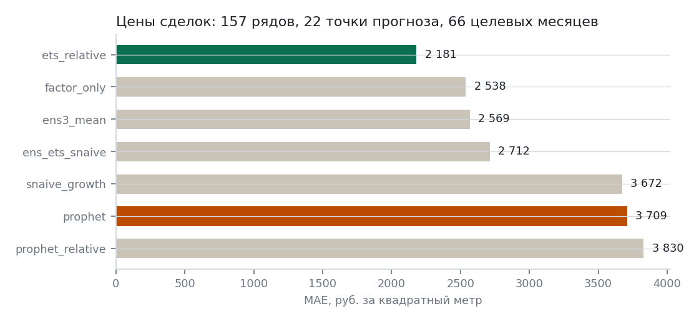

# Длинная панель: держится ли панельный приём, когда тестов хватает

Данные: СберИндекс, «Цены на недвижимость по фактическим сделкам», 85 регионов × два сегмента (первичный и вторичный рынок), январь 2017 — сентябрь 2026, рубли за квадратный метр. Полную историю имеют 155 рядов из 163. Строка «Россия» лежит в выгрузке в том же измерении, что и регионы; это агрегат, и из панели он исключён (`exclude_areas`). Прогон: `python -m siregions.cli forecast --config configs/deals.yaml`.

## Зачем это

У «Шока по расписанию» был слабый бок: 24 месяца истории, шесть целевых месяцев, и после поправки на перекрытие горизонтов тест Диболда–Мариано давал p = 0,18. Выводы пришлось строить на доле выигранных МО и бутстрапе. Здесь 117 месяцев, 22 точки прогноза, 66 целевых месяцев и 10 230 пар «ряд–точка–горизонт» — мощности достаточно.

## Результаты

| Модель | MAE, руб./м² | к Prophet | MAE к snaive | R² прироста г/г | h = 1 | h = 2 | h = 3 |
|---|---|---|---|---|---|---|---|
| ets_relative | 2 181 | −41 % | 0,18 | 0,89 | 1 235 | 2 215 | 3 094 |
| factor_only | 2 538 | −32 % | 0,21 | 0,86 | 1 636 | 2 564 | 3 416 |
| ens3_mean | 2 569 | −31 % | 0,21 | 0,85 | 1 658 | 2 602 | 3 448 |
| ens_ets_snaive | 2 712 | −27 % | 0,23 | 0,83 | 1 774 | 2 746 | 3 615 |
| snaive_growth | 3 672 | −1 % | 0,31 | 0,70 | 2 610 | 3 713 | 4 692 |
| prophet | 3 709 | — | 0,31 | 0,71 | 3 046 | 3 755 | 4 327 |
| prophet_relative | 3 830 | +3 % | 0,32 | 0,69 | 3 094 | 3 844 | 4 552 |
| snaive | 12 047 | +225 % | 1,00 | −2,06 | 12 008 | 12 054 | 12 079 |

*Средняя абсолютная ошибка моделей, рублей за квадратный метр*

Тесты с поправкой Ньюи–Уэста на перекрытие горизонтов и Харви–Лейборна–Ньюболда на малую выборку, плюс блочный бутстрап по 66 целевым месяцам:

| Сравнение | Разница MAE | p | Доля рядов, где лучше | Бутстрап, 95 % |
|---|---|---|---|---|
| ets_relative против prophet | −1 528 | < 0,0001 | 1,00 | от −1 685 до −1 369 |
| factor_only против prophet | −1 171 | < 0,0001 | 0,94 | от −1 361 до −973 |
| ets_relative против factor_only | −357 | 0,0007 | 0,95 | от −482 до −250 |
| snaive_growth против prophet | −38 | 0,57 | 0,57 | от −158 до +92 |
| prophet_relative против prophet | +121 | 0,069 | 0,43 | от +35 до +203 |

## Что подтвердилось, а что нет

**Панельный приём держится, и теперь это доказано как следует.** Контрольная модель `factor_only`, где ряд просто держит своё отклонение от общего фактора, обыгрывает Prophet на 32 % с p < 0,0001 и выигрывает в 94 % рядов. На муниципальных расходах тот же приём давал −34 % при p = 0,18 — величина эффекта почти та же, а значимость наконец соответствует.

**Моделировать отклонение здесь стоит.** ETS поверх приёма даёт ещё −357 руб. к `factor_only` (p = 0,0007, лучше в 95 % рядов). На муниципальной панели эта добавка была статистически неразличима — там сказывались 24 месяца истории.

**Перенос приёма на саму базовую модель не сработал.** `prophet_relative` оказался на 121 руб. хуже обычного Prophet (p = 0,069 с поправкой на перекрытие, p = 0,008 на непересекающихся целевых месяцах, хуже в 57 % рядов). На муниципальных расходах было наоборот: там приём давал Prophet −33 %. Объяснение в природе ряда: цены жилья сильно тренд­овые, Prophet свой тренд оценивает сам, а вычитание общего фактора ломает ему именно ту часть, которую он умеет. Приём помогает тем моделям, у которых нет собственного механизма тренда.

**Ансамбль здесь не нужен.** `ens3_mean` (2 569) хуже лучшей одиночной модели (2 181): усреднение с более слабыми участниками портит результат. На муниципальных расходах ансамбль выигрывал, потому что там модели были сопоставимы по силе и ошибались по-разному.

**Первичный рынок прогнозируется хуже вторичного** у всех моделей: 2 679 против 1 749 руб. у лучшей. Это ожидаемо: на первичном рынке цена зависит от состава проектов, выходящих в продажу.

## Как это читать вместе с муниципальной работой

Общий вывод двух работ один: источник точности — панель, а не алгоритм. Но детали различаются, и различия содержательные.

| | Расходы МО, 24 месяца | Цены сделок, 117 месяцев |
|---|---|---|
| Выигрыш приёма к Prophet | −34 % | −32 % |
| Значимость | p = 0,18 | p < 0,0001 |
| Добавка от моделирования отклонения | незначима | −357 руб., p = 0,0007 |
| Приём на самом Prophet | помогает (−33 %) | мешает (+3 %) |
| Ансамбль | помогает | мешает |

То есть переносится сам приём, а не рецепт целиком: что надстраивать поверх общего фактора, зависит от ряда и проверяется заново.
