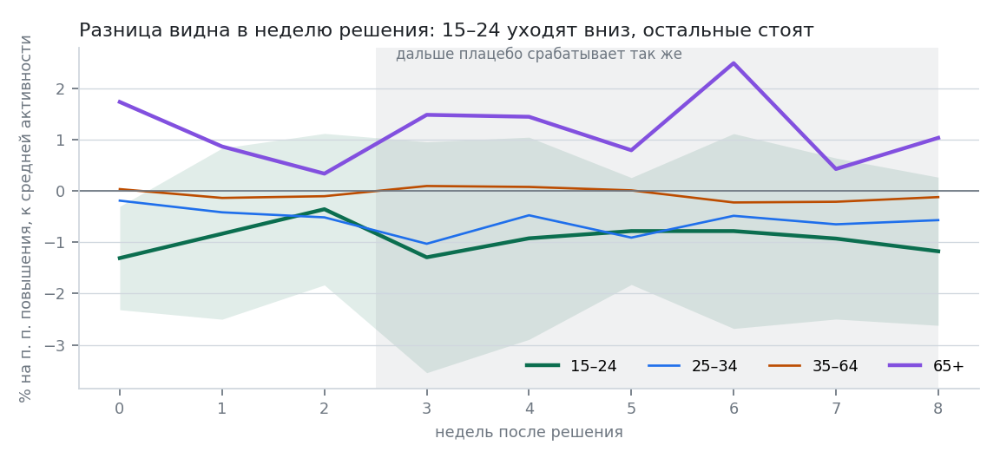
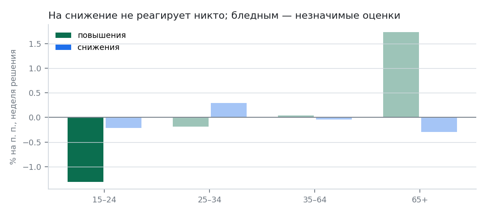

# Кто первым реагирует на ставку

Данные: СберИндекс, «Потребительская активность по категориям товаров в разрезе возрастов», недельный индекс по четырём возрастным группам и по всем возрастам, Россия целиком, 10.01.2021 — 04.10.2026, 300 недель. Реестр решений ЦБ — `data/events/cbr_decisions.csv`: 34 заседания с изменением или сохранением ставки, из них 15 плановых повышений, 15 плановых снижений и 3 внеочередных решения. Даты сверены с календарём заседаний Банка России и таблицей «Гаранта» по датам вступления в силу. Прогон: `python -m siregions.cli rate --config configs/rate.yaml`.

## Как устроен вопрос

«Кто первым» — вопрос о разнице между группами, а не об уровне трат. Поэтому основная переменная — отклонение логарифма активности группы от логарифма активности всех возрастов. Всё общее (праздники, погода, выплаты, сам макрошок) уходит, остаётся различие в реакции. Это тот же панельный приём, что и в остальных работах репозитория.

Оценка — локальные проекции: для каждого горизонта h своя регрессия прироста за h недель на величину изменения ставки в неделю решения, с недельной сезонностью, позицией недели в месяце (зарплатные циклы), трендом и лагами. Ошибки Ньюи–Уэста.

Недели в выгрузке помечены воскресеньем, решение принимается в пятницу — значит, новость попадает в ту же неделю, и это горизонт h = 0.

## Главный результат

Плановые повышения ставки, 15 событий, неделя решения, в процентах на процентный пункт повышения, относительно средней активности:

| Группа | Коэффициент | Ст. ош. | p (Ньюи–Уэст) | p (перестановки) |
|---|---|---|---|---|
| 15–24 | −1,31 | 0,51 | 0,011 | 0,054 |
| 25–34 | −0,19 | 0,46 | 0,69 | 0,61 |
| 35–64 | +0,04 | 0,18 | 0,84 | 0,86 |
| 65+ | +1,74 | 1,09 | 0,11 | 0,042 |

Самая молодая группа сокращает траты в ту же неделю, когда объявлено решение. Повышение на 1 процентный пункт — минус 1,3 % к тому, что эта группа потратила бы при обычной для неё динамике; при подъёме на 2 пункта (как 27 октября 2023 года или 25 октября 2024 года) это минус два с половиной процента за неделю. Середина — 25–34 и 35–64 — не двигается вовсе.

*Отклик по возрастным группам на плановые повышения ставки*

Разница держится недолго: к третьей неделе она растворяется (см. ниже про горизонты).

## Что проверено

**Перестановочный тест.** Те же изменения ставки раскладываются по случайным неделям, 500 расстановок. Доля расстановок, дающих коэффициент не меньше наблюдаемого по модулю: 0,054 для 15–24 на плановых повышениях, 0,006 на всём наборе решений, 0,042 на наборе без 2022 года. Это нужная проверка, потому что обычные p-значения локальных проекций при перекрывающихся окнах врут — см. плацебо ниже.

**Исключение по одному событию.** Коэффициент 15–24 при выбрасывании любого одного заседания остаётся в диапазоне от −1,50 до −1,00, p не превышает 0,051. Без 2022 года: от −1,28 до −0,98, p не больше 0,019. Результат не держится ни на одном конкретном решении.

**Разные наборы событий.** Все решения: −0,68 (p перестановок 0,006). Плановые, без 2022 года: −1,15 (0,042). Плановые повышения: −1,31 (0,054). Все плановые решения вместе, повышения и снижения в одной регрессии: −0,54 и незначимо — потому что такая спецификация требует симметричной реакции, а её нет.

**Плацебо.** Весь набор событий сдвигается на 4 недели вперёд и на 6 недель назад. В неделю фиктивного решения — ничего ни у одной группы (p ≥ 0,095). Зато на горизонтах от трёх недель плацебо даёт «значимые» коэффициенты не хуже настоящих. Отсюда правило этой работы: ничего, кроме первых двух недель, здесь утверждать нельзя, и дальние горизонты в выводы не идут.

**Чего проверки не выдержали.** Коэффициент +1,74 у группы 65+ рассыпается при исключении по одному событию: диапазон от +0,58 до +2,60, p доходит до 0,49, а без 2022 года интервал пересекает ноль. В сыром окне вокруг событий, без сезонных поправок, у этой группы и вовсе отрицательные медианы. Поэтому «пенсионеры на повышении ставки тратят больше» — не результат, а намёк, и на картинке этот столбец приглушён.

## Асимметрия и оговорка к ней

На плановых снижениях ставки нет реакции ни у одной группы: 15–24 −0,22 (p = 0,62), 25–34 +0,29 (0,25), 35–64 −0,04 (0,71), 65+ −0,30 (0,47).

*Неделя решения: повышения против снижений; бледным — незначимые оценки*

Соблазнительно сказать «люди реагируют на ужесточение и не реагируют на смягчение». Но все 15 плановых снижений в выборке пришлись на 2025–2026 годы, а все повышения — на 2021–2024-й. Отличить асимметрию от смены периода на этих данных нельзя, и это ограничение, а не деталь.

## Границы

1. Индекс измеряет траты по картам Сбера в товарных категориях, а не потребление. Группа 15–24 — самая маленькая и самая изменчивая: недельное стандартное отклонение прироста 5,1 % против 4,8 % у всех возрастов и 7,3 % у 65+.
2. Решение о ставке не случайно: оно принимается в ответ на инфляцию и прочее, что одновременно влияет на траты. Относительная мера убирает общую часть, но если ужесточение раз за разом совпадает с чем-то, что бьёт именно по молодым, оценка это и поймает.
3. Сюрприз от решения не отделён от ожидаемой части: рыночных ожиданий по ставке в выгрузках нет.
4. Данные только по стране целиком: регионального разреза в этом наборе нет, поэтому отдельно по Татарстану ничего сказать нельзя.
5. Горизонт выводов — две недели. Всё, что дальше, плацебо-проверку не проходит.

## Как это читать

Группа 15–24 почти не имеет ипотеки и крупных кредитов — значит, мгновенная реакция идёт не через платёж по долгу, который к тому же меняется не в день решения. Остаётся канал ожиданий: новость о ставке меняет готовность тратить раньше, чем меняются сами условия кредита. Это ровно та механика, за описание которой Майкл Вудфорд и Роберт Холл получили премию по экономике 12 октября 2026 года: ставка действует через ожидания и межвременное замещение, а не только через стоимость денег.

Но важно и обратное: у тех, кто платит по кредитам и ипотеке — 25–34 и 35–64, — в неделю решения не происходит ничего. Канал долга работает медленно и в недельных данных не виден.
