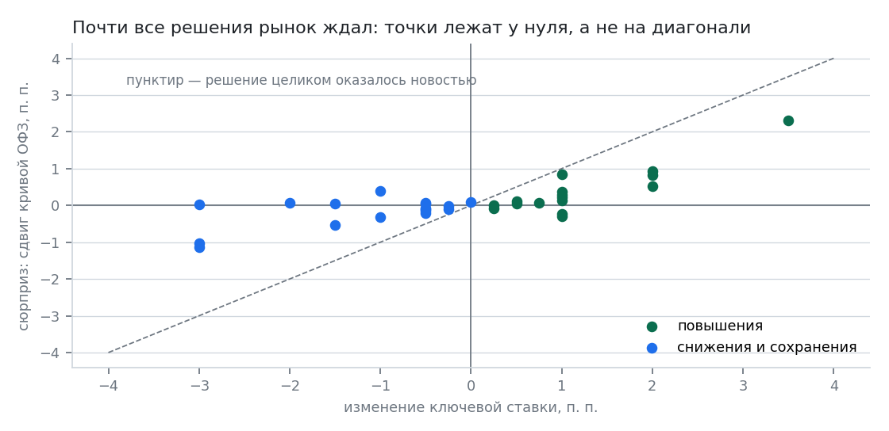
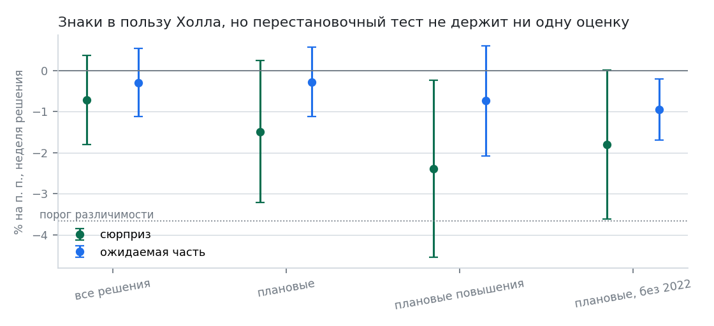

# Сюрприз против ожидаемой части: проверка предсказания Холла

## Зачем

В исследовании «Кто первым реагирует на ставку» (`docs/rate.md`) реакция трат меряется на
изменение ключевой ставки целиком. Это не то, что предсказывает гипотеза постоянного
дохода. По Холлу (1978) потребление меняется только от новостей, а дата заседания известна
заранее и бо́льшая часть решения заложена в ожидания. Реагировать должна не вся величина
изменения, а только её неожиданная часть.

Здесь изменение каждого решения раскладывается на сюрприз и ожидаемую часть, и отклик
оценивается на обе части сразу. Если Холл прав, коэффициент при ожидаемой части должен
быть нулевым.

## Как измерен сюрприз

Не разницей между решением и опросом аналитиков: открытого машиночитаемого ряда
консенсус-прогнозов по России нет, а те, что публикуют издания, собраны по разным
выборкам и нигде не архивируются. Взята стандартная схема высокочастотной идентификации
(Kuttner 2001; Gürkaynak, Sack, Swanson 2005) — сюрприз это сдвиг короткого конца рыночной
кривой в день решения.

Источник: кривая бескупонной доходности ОФЗ Банка России (КБД), дневная, срок 0,25 года,
`data/raw/cbr_zcyc_2021_2026.csv` (1453 торговых дня, 04.01.2021 – 12.10.2026,
sha256 `928cc479…`, выгружена с cbr.ru/hd_base/zcyc_params/ по кварталам).

Окно: последний торговый день строго до заседания и день самого заседания. Решение
объявляется в 13:30 МСК, торги закрываются позже, поэтому дневное значение за день
решения новость уже содержит, а за предыдущий день — ещё нет.

Ожидаемая часть — остаток: изменение ставки минус сюрприз.

Два ограничения названы сразу. Первое: доходность на сроке 0,25 года это средняя
ожидаемая ставка на квартал плюс премия за срок; разовое изменение уровня, которое рынок
считает устойчивым, переносится в неё почти один к одному, но для решений, которые рынок
считает временными, сюрприз занижен. Премия за срок за один день меняется мало и в
разности в основном сокращается. Второе: заседание 28.02.2022 выпадает — торги в эти дни
были остановлены, котировок в окне нет. Из 33 изменений ставки в оценку входят 32.

Альтернатива чище — ставки процентных свопов на RUONIA (ROISfix): это прямое ожидание
по ставке без премии за срок. Ряд закончился 01.03.2022 (фиксинг НФА прекращён), а
индикаторы Мосбиржи RUSFAR из рабочего контура недоступны. Поэтому основная мера — КБД.

## Что получилось

Разложение ведёт себя разумно: сюрпризы малы относительно самих решений и велики там, где
этого ждёшь. Экстренное повышение 15.08.2023 на 3,5 п.п. даёт сюрприз 2,3 п.п., плановое
повышение 25.10.2024 на 2 п.п. — 0,83 п.п., а решения, которые рынок ждал (например,
снижение 25.07.2025 на 2 п.п.), дают сюрприз около нуля.

Отклик группы 15–24 в неделю решения, плановые повышения (15 событий), в процентах
на процентный пункт:

| часть изменения | коэффициент | ст. ошибка | p (Ньюи–Уэст) | p (перестановки) |
|---|---|---|---|---|
| сюрприз | −2,40 | 1,31 | 0,068 | 0,248 |
| ожидаемая часть | −0,74 | 0,82 | 0,366 | 0,494 |

Знаки — ровно те, что предсказывает Холл: реакция сидит на сюрпризе, ожидаемая часть
ничего не объясняет. Соотношение устойчиво к выбору срока и окна: на сроках 0,25 / 0,5 / 1
года и при сдвиге окна на следующий торговый день коэффициент при сюрпризе лежит
в диапазоне от −2,1 до −3,2, при ожидаемой части — от −0,7 до −1,0.

## Чего не получилось

Перестановочный тест предсказание не подтверждает. Те же пары (сюрприз, ожидаемое),
разложенные по пятистам случайным наборам недель, дают коэффициент не меньше
наблюдаемого в 25 % случаев. По остальным вариантам набора решений — от 25 до 45 %.
Это не «слабая значимость», а отсутствие идентификации.

Обратный случай стоит назвать отдельно, чтобы его не нашли за меня. На наборе «плановые,
без 2022» значимым по Ньюи–Уэсту выглядит коэффициент при ожидаемой части (−0,95, p 0,036) —
то есть ровно то, чего по Холлу быть не должно. Перестановочный тест и его не держит
(p 0,214), так что это та же нехватка мощности, а не контрпример к теории. Но показывает,
насколько легко на этих данных получить «значимый» результат любого знака.

Причина видна в разбросе. На плановых повышениях стандартное отклонение самого изменения
ставки 0,58 п.п., а сюрприза — 0,38 п.п., и они скоррелированы на 0,70. Минимальный
обнаружимый эффект при такой вариации — 3,7 % на процентный пункт сюрприза, а оценка
−2,4 %. Схема физически не может отличить этот эффект от нуля: не хватает ни числа
заседаний, ни разброса неожиданной части.

## Вывод

Предсказание Холла на этих данных проверить нельзя, и это результат, а не неудача:
направление совпадает с теорией, но мощности схемы не хватает, чтобы на этом настаивать.
Что отсюда следует для основной работы:

1. Утверждение, которое остаётся, — прежнее: траты группы 15–24 падают в неделю решения
   на 1,3 % на процентный пункт изменения ставки. Это реакция на изменение целиком.
2. Утверждать, что реакция идёт только на неожиданную часть, нельзя. Точечные оценки
   в эту сторону, но перестановочный тест их не держит.
3. Чтобы довести проверку до конца, нужен либо ряд свопов на ставку (ROISfix до марта
   2022-го плюс его преемник), либо больше заседаний: чтобы минимальный обнаружимый
   эффект опустился до наблюдаемых −2,4 %, выборка должна вырасти примерно в два
   с половиной раза.

Код: `src/siregions/surprise.py`. Данные: `data/raw/cbr_zcyc_2021_2026.csv`.
